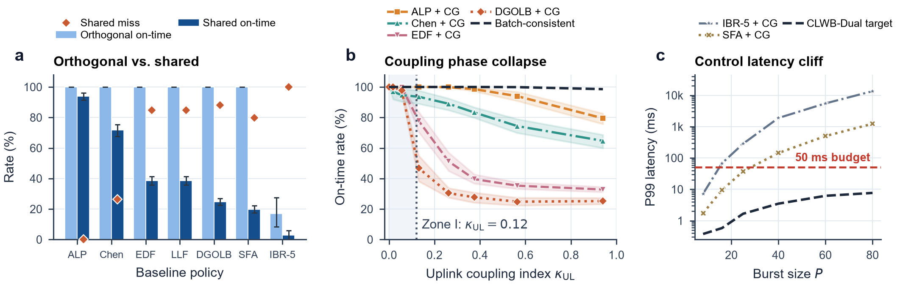

# CLWB-Dual: Causal Continuous-Fluid Modeling and Sublinear-Verification Real-Time Admission Control

[](LICENSE)
[](requirements.txt)
[](#quick-start)

Official reproducibility artifact for our *Computer Networks* manuscript:

> **Cross-Layer Coupling in Shared-Uplink Wireless Edge Computing: Causal Continuous-Fluid Modeling and Sublinear-Verification Real-Time Admission Control**  
> Sihan Xia, Jing Wu, Chenyan Yu, Yijun Liu, and Wei Hu  
> Wuhan University of Science and Technology

---

## Executive Summary

In shared-uplink mobile edge computing, co-channel interference prolongs uplink transmissions and compresses residual compute slack, inflating required edge server CPU frequencies quadratically as $1/\mathrm{slack}^2$. Sequential or iterative exact admission solvers require $O(P^2 M)$ continuous-fluid rollouts per control tick and stall under bursty traffic. This repository contains the complete causal continuous-fluid model ($\mathcal{P}_{\mathrm{ECU}}$), the online scheduler `CLWB-Dual`, baselines, audit harnesses, and reproduction scripts:

1. **Causal Continuous-Fluid Simulator & Exact Oracle (`stage2_model/`)**: Vectorized continuous-event Shannon interference integration, half-duplex NIC queueing, endogenous $1/\mathrm{slack}^2$ compute inversion, O-RAN Near-RT RIC / Linux `SCHED_DEADLINE` timing semantics, and exact offline branch-and-bound / MILP reference oracles.
2. **Sublinear-Verification Downward-Closed Scheduler (`stage3_algorithm/champion_core.py`)**: Two-pass local packing, idle-radio filtering and causal deferral, optional gated Pigouvian--EDF guard for extreme near-far inversions, $O(\log P + M)$ binary prefix contraction with $2M+2$ spatial-reuse fill, and $f_r^{\mathrm{base}}$-capped non-hoarding frequency margins.
3. **Theorem Stress Audits, Full Benchmarks & Native x64 Reference (`stage4_audit/`, `formal_experiments/`, `supp_verification/`)**: 10,000-case property verification suite, 24-workload matrix (1,920 episodes), 64-scenario *Azure Functions Trace 2019* replays, C# `.NET x64` compiled verifier (`supp_verification/fluid_bench_x64.cs`), and all 8 publication-ready figures (`figures/`).

<p align="center">
  
</p>

---

## Repository Structure

```text
CLWB-Dual/
├── stage2_model/             # Causal continuous-fluid env (P_ECU), baselines, exact oracle, freeze hash
├── stage3_algorithm/         # Frozen CLWB-Dual policy (champion_core.py), +CG guardrail, L1-L3 & CE2
├── stage4_audit/             # Blind/hardware suites, grafting, sensitivity, 10k theorem fuzzing, phase map
├── formal_experiments/       # Stage-5 batch runners, 19 aggregated CSV datasets, & summary JSONs
├── supp_verification/        # Same-engine SFA, budget-capped SFA, C# native x64 benchmark, & plotters
├── trace_data/trace_extract/ # 32 pre-extracted Azure Functions Trace 2019 quantile .npz payloads
├── figures/                  # All 8 vector PDFs and 300 DPI PNGs included in the manuscript
├── scripts/
│   ├── verify_all.py         # 4-gate master verifier (upstream hashes, headline stats, live smoke, manifest)
│   └── make_manifest.py      # Regenerate MANIFEST.sha256 for tracked files
├── MANIFEST.sha256
├── CITATION.cff
├── LICENSE
└── requirements.txt
```

---

## Quick Start

Clone the repository and run the 4-gate verification suite in a Python 3.11+ environment (runs in a few seconds with all trace assets included locally):

```bash
git clone https://github.com/Liberation1949/CLWB-Dual.git
cd CLWB-Dual
pip install -r requirements.txt

# Verify upstream frozen hashes, CSV/JSON headline metrics, live smoke episodes, and MANIFEST.sha256
python -B scripts/verify_all.py

# Optional: Regenerate all 8 publication figures into figures/
python -B supp_verification/replot_nature_figures.py

# Optional: Re-run supplemental audit suites (read-only toward Stage 2-4)
python -B supp_verification/run_planb_audit.py
python -B supp_verification/run_final_fairness_audit.py
```

### What `scripts/verify_all.py` Checks

- **Gate 1 (Frozen Integrity & Trace Assets)**: Runs `verify_upstream_readonly()` across `stage2_model/`, `stage3_algorithm/`, and `stage4_audit/`, and confirms all 32 Azure `.npz` payloads in `trace_data/trace_extract/`.
- **Gate 2 (Summary & Headline Metric Audit)**: Verifies all 19 CSV datasets under `formal_experiments/data_csv/` and key metrics across `stats/b2_summary.json`, `stats/b4_summary.json`, and `supp_verification/revision_audit_results.json` (`97.94%` on `Main K=12`, `96.89%` on `All K=24`, `99.63%` on 64 Azure traces, `9.03 ms` max P99 at `P=200`, and `0.568 ms` native x64 mean check time).
- **Gate 3 (Live Simulator Smoke Checks)**: Executes live episodes of `CLWB-Dual` vs.\ pre-batch `DGOLB+CG` on `CE_2ndOrder` (`4/5` vs.\ `1/5`) and verifies `WK01_BALANCED_MED` achieving `100.0%` on-time completion with `0` skipped ticks.
- **Gate 4 (`MANIFEST.sha256`)**: Verifies exact SHA-256 digests across all tracked files in the repository.

### Compiling the Optional Native x64 Benchmark

The native x64 verification benchmark (`supp_verification/fluid_bench_x64.cs`) compiles on Windows with `.NET Framework` (`csc.exe`) or Mono (`mcs`):

```bash
csc /optimize+ /platform:x64 /out:supp_verification/fluid_bench_x64.exe supp_verification/fluid_bench_x64.cs
python -B supp_verification/run_revision_audits.py
```

---

## Citation

If you find this repository helpful in your research, please cite:

```bibtex
@article{Xia2026CLWBDual,
  author  = {Sihan Xia and Jing Wu and Chenyan Yu and Yijun Liu and Wei Hu},
  title   = {Cross-Layer Coupling in Shared-Uplink Wireless Edge Computing: Causal Continuous-Fluid Modeling and Sublinear-Verification Real-Time Admission Control},
  journal = {Computer Networks},
  year    = {2026}
}
```
